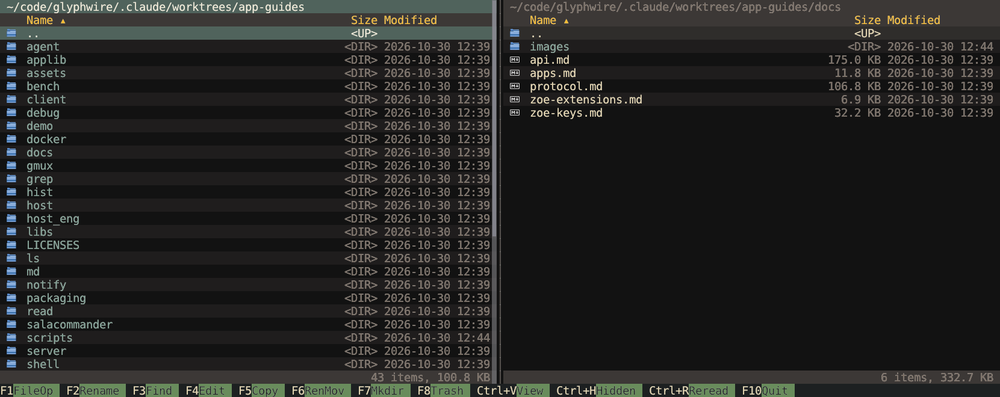
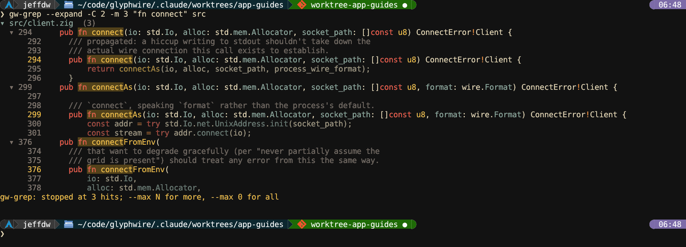
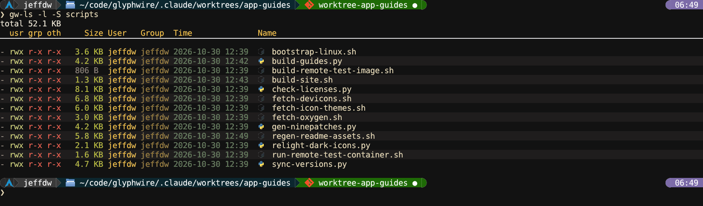
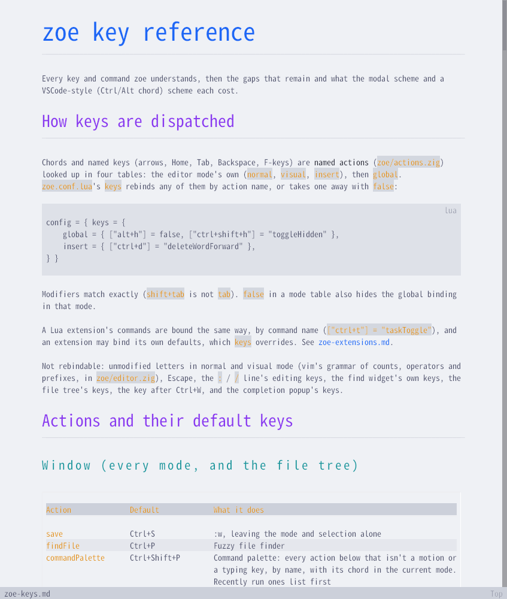

<!-- SPDX-License-Identifier: CC-BY-4.0 -->
# glyphwire


[](#license)

A 2D-grid terminal replacement. Programs talk to the display over a local
socket with structured JSON-RPC (or MessagePack) messages instead of a
stream of ANSI escape sequences, and get real layers, tables, images,
splits and panes back.

**Website: [srjilarious.github.io/glyphwire](https://srjilarious.github.io/glyphwire/)**

- **No client library needed.** Anything that can open a Unix socket can
  speak the protocol. The Zig `Client` in `src/client.zig` is a convenience.
- **Graceful fallback.** A program finds the session through
  `GLYPHWIRE_SOCK`; without it, it writes plain stdout.
- **Still a terminal.** Plain programs run on a PTY and their escape
  sequences are interpreted, so ordinary terminal programs keep working.
- **State lives server-side.** Layers, tables, outlines, panes and contexts
  outlive the process that made them and are redrawn by the host without a
  round trip.
- **Atomic frames.** A `batch` applies many messages under one lock, so a
  listing appears whole instead of painting a band at a time.


## The protocol

The wire protocol is at **version 0.10.0**, a pre-1.0 draft.
[`docs/protocol.md`](docs/protocol.md) is the normative specification
(CC-BY-4.0), enough to write a client or a host in any language without
reading the Zig. [`docs/api.md`](docs/api.md) is the annotated message
catalog with per-message implementation status.

- **Transport.** A Unix domain stream socket, found through
  `GLYPHWIRE_SOCK`. Other variables seat a process in a pane
  (`GLYPHWIRE_PANE`) or on a layer (`GLYPHWIRE_LAYER`), or mark a remote
  session.
- **Two encodings, one message shape.** JSON-RPC 2.0 bodies under
  `Content-Length` headers, or length-prefixed MessagePack after a four-byte
  `c1 47 57 4d` preamble. The host tells them apart by the first byte and
  answers each connection in its own encoding. The reference client
  defaults to MessagePack; `GLYPHWIRE_WIRE=json` switches it back.
- **Binary without base64.** Image bytes ride a raw side channel after the
  JSON frame, or inline `bin` on MessagePack.
- **Object model.** Contexts (independent full-window surfaces) hold layers
  in a split tree; layers hold cells, tables, outlines, rects, images,
  nine-patches and metadata. Panes are a separate window-level split tree,
  each seating a context and a host-managed PTY. Everything is addressed by
  integer handle.
- **Catalog.** About 110 methods (requests and notifications) and some two
  dozen notification kinds over opt-in subscription streams: key, text,
  mouse, scroll, resize, focus, selection, clipboard, theme, panes, layout
  and more.
- **Themes are roles, not colours.** Programs paint a palette slot or a
  named role (`keyword`, `table_header_bg`, `divider`, ...) and the host
  resolves it at draw time, so a theme switch recolours what is already on
  screen.

Known gaps, called out in the spec: a failed request severs the connection
rather than returning an error response, and there is no capability
negotiation yet (`get_version` reports the host and protocol version, but
nothing adapts to it). Both are expected before 1.0.

### Server-side features

| Feature | Key messages | What it gives you |
|---|---|---|
| **Contexts** | `create_context`, `activate_context`, `attach_context` | Independent full-window surfaces. A generalized alt-screen: the shell's scrollback sits untouched under a full-screen app and reappears when it exits. Super+F12 switches between them. |
| **Panes** | `create_pane`, `spawn_in_pane`, `focus_pane`, `set_window_prefix` | Window-level split tree of panes, each running its own program on a host-managed PTY. What `gmux` is built on. |
| **Splits** | `create_split`, `set_split_children`, `replace_split_child`, `move_divider` | Layout tree of layers inside a context, with weighted or fixed children and draggable dividers that keep their ratios. Re-lays itself on window resize. |
| **Layers** | `create_layer`, `raise_layer`, `get_property` / `set_property` | Addressable surfaces with position, size, visibility, opacity, background and drop shadow. A viewport over a larger content grid scrolls host-side, with opt-in scrollbars. |
| **Text** | `write_text`, `insert_cells`, `delete_cells`, `move_content`, `set_bg`, `set_fg` | Truecolor styled runs, text scale (1.5x, 2x, 3x) from re-rasterized font atlases, colour emoji, in-place cell editing, row shifting without a repaint, and background- or foreground-only repaints for moving a highlight. |
| **Images** | `load_image`, `update_image`, `draw_image` | Real bitmaps (PNG, JPEG, BMP, GIF) placed in the grid, with source cropping. |
| **Icons and panels** | `draw_icon`, `create_nine_patch` | A bundled icon catalog (file types, Devicon logos, distro logos) and nine-patch panels from `.9.png` art, corners at native pixel size. |
| **Rects** | `create_rect`, `update_rect` | Pixel-space outlines and fills on a layer, independent of the cell grid. |
| **Tables** | `create_table`, `table_set_rows`, `table_set_sort`, `table_set_style` | Typed, sortable tables with column widths, alignment and cell wrapping. Click-to-sort keeps working after the client exits. |
| **Outlines** | `create_outline`, `outline_set_nodes`, `outline_set_collapsed` | Collapsible trees the host expands and collapses on a click, with nothing running. What `gw-grep` draws. |
| **Metadata** | `create_metadata`, `tag_metadata`, `find_metadata` | Opaque client JSON attached to cells: a path to open, a link to follow. The server stores it and never parses it. |
| **Drag and drop** | `start_drag`, `set_drop_target`, `create_metadata`'s `drag` | Drag files out of the grid into other desktop programs on Wayland, and accept drops onto a highlighted target. |
| **Selection and clipboard** | `set_selection`, `get_selection_text`, `set_clipboard` | Host-drawn selection per layer, mirrored to the OS clipboard. |
| **Highlights** | `toggle_highlight`, `set_highlight` | Multi-select by metadata id, drawn by the host. |
| **Themes** | `set_theme`, `get_theme`, the `theme` stream | Nineteen built-in themes plus your own, per window or per context, switched live (Super+F10) with a preview. |
| **Batching** | `batch` | Many messages applied in one pass as one rendered frame. |
| **Input** | `subscribe`, `set_key_repeat`, `get_input_state` | Opt-in key, text, mouse, resize and scroll events with modifier state. Per-program key repeat cadence. |
| **Remote sessions** | `start_remote`, `stop_remote` | Remote glyphwire clients drawing into a local pane over one ssh trunk (`gw-agent` on the far side). |

Planned: server-driven animation, action maps, capability negotiation,
wheel and gamepad streams.

## Applications

Each is an ordinary client of the protocol, versioned on its own.
[`docs/apps.md`](docs/apps.md) has the full feature list for each.

| App | Version | What it is |
|---|---|---|
| **`gw-shell`** | 0.11.0 | The shell `glyphwire` spawns. Pipelines, Lua config, fish-style autosuggestions, fish and Lua completions, powerline prompt, Ctrl+R / Alt+C through `gw-hist`, `gwssh`. |
| **`zoe`** | 0.19.0 | Modal editor: vim grammar with VS Code keys alongside. Split editor groups, workspaces, tree-sitter highlighting, LSP (diagnostics, hover, goto, completion), find and replace, folding, Lua extensions, unsaved-change backups. Keys in [`docs/zoe-keys.md`](docs/zoe-keys.md). |
| **`gmux`** | 0.11.0 | Multiplexer as a pure window manager: it draws nothing and never touches a program's I/O, it only asks the server for panes. |
| **`salacommander`** | 0.10.0 | Two-pane file manager: icons, tabs, sudo operations, trash, permission editing, drag and drop within and out of the window. |
| **`gwmd`** | 0.8.0 | Markdown reader: scaled headings, GFM tables as native tables, inline images, links. |
| **`gw-read`** | 0.9.0 | Comic and manga reader: zoom and pan, Mokuro OCR overlays, dictionary lookup, AI bubble translation, Anki mining. |
| **`gw-ls`** | 0.8.0 | `ls` as an icon grid, or a long listing in a table that stays sortable after it exits. |
| **`gw-grep`** | 0.8.0 | ripgrep hits as a collapsible, highlighted outline in the scrollback. |
| **`gw-hist`** | 0.8.0 | Fuzzy history and frecent-directory search for `gw-shell`. |
| **`gw-view`** | 0.8.0 | Image viewer, inline or interactive. |
| **`gw-agent`** | 0.8.0 | The remote end of an ssh session; bridges remote clients onto one trunk. |

Developer tools: `glyphwire-probe` drives and inspects a live session
from the command line (`zig build probe`), and `glyphwire-demo`,
`glyphwire-table-demo` and `glyphwire-notify` exercise parts of the
protocol.

### Screenshots

salacommander, the repository on the left and `docs/` on the right:



`gw-grep` hits as an outline in the shell's scrollback:



`gw-ls -l -S`, a long listing in a server-side table:



gwmd reading `docs/zoe-keys.md` under the Catppuccin Latte theme:



More on the [website](https://srjilarious.github.io/glyphwire/).

## Build and run

Requires Zig 0.17.0. Dependencies are fetched or
vendored; SDL3 builds from source, so no system dev packages are needed.

| Command | Effect |
|---|---|
| `zig build` | Build every executable into `zig-out/bin/` |
| `zig build glyphwire` | Build and run the host (spawns `gw-shell`) |
| `zig build tests` | Run the test suite |
| `zig build package` | Shipped programs, grammars and assets into `zig-out/` |
| `zig build install-local --prefix /usr/local` | Install everything under a prefix |

Each program also has its own run step (`zig build zoe`, `zig build gwmd`,
...).

Every program answers `--version` (or `-V`) with its own version, the
glyphwire release and the `git describe` it was built from, e.g. `zoe
0.19.0 (glyphwire 0.21.0, 1b122a9)`. Each program's number is a line in
`program_versions` at the top of `build.zig`, bumped when that program
changes in a release, and the release's own number is `build.zig.zon`'s
`version`. A client can ask the host the same with the `get_version`
request.

CI builds `glyphwire-linux-x86_64.tar.gz`, a `.deb` and an Arch
`.pkg.tar.zst` on every push to `main`, and attaches all three to the GitHub
Release on a `vX.Y.Z` tag. The binaries need glibc 2.39 or newer (Ubuntu
24.04, Debian 13, current Arch). Install a downloaded package with:

```sh
sudo apt install ./glyphwire_<version>-1_amd64.deb          # Ubuntu / Debian
sudo pacman -U glyphwire-<version>-1-x86_64.pkg.tar.zst     # Arch
```

### Host options

| Option | Effect |
|---|---|
| `--ssh <dest>` | Open a remote session to `dest` |
| `--remote-command <cmd>` | The `gw-agent` command to run on the remote side |
| `--grid-cols <n>` / `--grid-rows <n>` | Starting grid size |
| `--screenshot <path>` | Write the grid to a PNG after a delay, then quit |
| `--screenshot-delay-ms <n>` | Delay before the capture (default 2500) |

Other arguments pass through to `gw-shell`. Setting `GLYPHWIRE_SHELL_SCRIPT`
to a file replays its lines at the prompt before interactive input starts.

## Configuration

Every config file is Lua, named `*.conf.lua`, and read from
`$GLYPHWIRE_CONFIG_DIR`, else `$XDG_CONFIG_HOME/glyphwire`, else
`~/.config/glyphwire`. All fields are optional.

| File | Configures | Reference |
|---|---|---|
| `host.conf.lua` | Font face, fallbacks and size, colour emoji, cursor, grid size, scrollback, icon theme, the context switcher (Super+F12) and theme switcher (Super+F10) chords | `host/host.conf.template.lua` |
| `theme.lua` | The window's colour theme: a 24-slot ANSI palette and the shared roles every program paints with. Nineteen built-ins (Catppuccin, Tokyo Night, Solarized, Dracula, Nord, Gruvbox, VS Code Light and more) or your own | `host/theme.template.lua` |
| `shell.conf.lua` | Aliases, prompt segments, `zj` directory jumping, completions, hooks | `shell/shell.conf.template.lua` |
| `gmux.conf.lua` | Prefix key, pane shell, scrollback | `gmux/gmux.conf.template.lua` |
| `zoe.conf.lua` | Languages, grammar path, theme, editor options, language servers, key bindings, extensions | `zoe/zoe.conf.template.lua` |
| `ls.conf.lua` | Icon sizes | `ls/ls.conf.template.lua` |
| `read.conf.lua` | Reading direction, sizing, zoom, cache | `read/read.conf.template.lua` |
| `salacommander.conf.lua` | Key bindings, open actions, F4 editor | `salacommander/salacommander.conf.template.lua` |

`assets/*.conf.example.lua` are working setups to copy from. At runtime,
`Ctrl+-` / `Ctrl++` change the font size and `Ctrl+0` resets it. The window
keeps its size and the grid gains or loses cells to match.

## Repository layout

| Path | What |
|---|---|
| `src/` | Protocol core: grid model (`core.zig` for cells and `Layer`, with `vt.zig` for its VT machine), layer components (`table.zig`, `outline.zig`, `rect.zig`, `nine_patch.zig`), `context.zig`, `session.zig`, dispatch, server, client (`client.zig`, `client_ops.zig`), wire framing and codecs, PTY |
| `applib/` | Helpers shared by two or more applications: line editor, keymaps, fuzzy finder, shell panel, tab strip, history, file operations |
| `host/`, `host_eng/` | `glyphwire`, the SDL3 / OpenGL host, and its engine backend |
| `shell/`, `hist/` | `gw-shell` and `gw-hist` |
| `zoe/`, `gmux/`, `salacommander/`, `md/`, `read/`, `ls/`, `grep/`, `view/` | Applications |
| `agent/` | `gw-agent`, the remote end of an ssh session |
| `debug/`, `demo/`, `table-demo/`, `notify/`, `client/`, `server/` | Developer tools and demos |
| `tests/` | testz suite |
| `docs/` | Protocol spec, API reference, app and key references |
| `site/` | The project website, published to GitHub Pages |

## Regenerating the screenshots

```sh
scripts/regen-readme-assets.sh            # all scenes
scripts/regen-readme-assets.sh ls-grid    # just one
```

Scenes are defined at the top of the script. `docs/images/gw-read.png` is
taken by hand. The website uses the same images, copied in when the Pages
workflow builds it.

## Contributing: issues welcome, forks encouraged

glyphwire follows a **remix model**. It is one person's vision of what a
terminal could be, and it moves quickly in the direction that person
wants.

- **Issues are the way in.** Bug reports, reproduction cases, feature
  requests, design feedback and questions are all welcome, and need no
  agreement of any kind.
- **Fork it and make it yours.** The licences are chosen so you can take
  the protocol, the plumbing or the apps and build your own take on them.
  You don't need permission, and you don't need to send it back.
- **Pull requests are not the normal path.** An unsolicited PR will most
  likely be closed, however good it is, because merging it means
  maintaining someone else's direction. If you think a change belongs
  here, open an issue first; on the rare occasion a PR is invited, it is
  accepted under the [Contributor Licence Agreement](CLA.md).

[`CONTRIBUTING.md`](CONTRIBUTING.md) has the details, and the build, test
and licensing conventions for anyone working on a fork.

## License

Full detail in [`LICENSE.md`](LICENSE.md); third-party code and assets in
[`THIRD-PARTY.md`](THIRD-PARTY.md).

| Part | License | Meaning |
|---|---|---|
| **The protocol**: `docs/` | `CC-BY-4.0` | Implement it in any language, under any license. |
| **The plumbing**: `src/`, `applib/`, `host/`, `host_eng/`, `server/`, `client/`, `agent/`, demos and debug tools | `MPL-2.0` | File-level copyleft: owe source only for MPL files you change. |
| **The applications**: `gw-shell`, `gw-hist`, `gmux`, `gw-ls`, `gw-grep`, `gw-view`, `gw-read`, `gwmd`, `zoe`, `salacommander` | `GPL-3.0-or-later` | Programs people run, not components people embed. |

Every source file carries an `SPDX-License-Identifier`. The default icon
theme (Oxygen) is LGPL-3.0 and Papirus is GPL-3.0; set
`icon_theme = "material"` for the MIT Material theme if that matters.

Copyright (c) 2026 Jeff DeWall.
