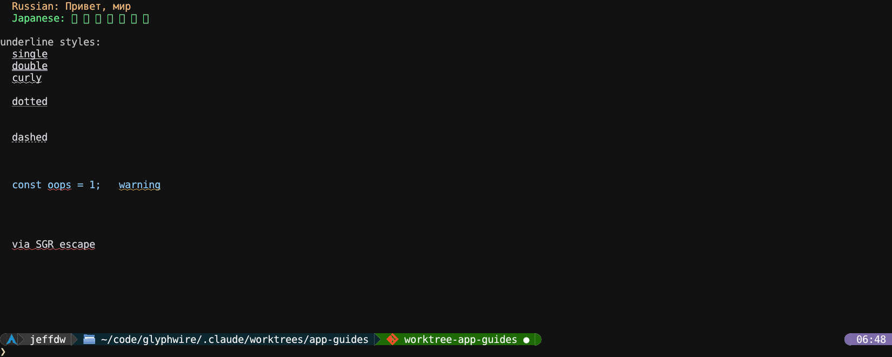

<!-- SPDX-License-Identifier: CC-BY-4.0 -->
# The window: glyphwire

`glyphwire` is the program that opens the window. It draws the grid,
reads the keyboard and mouse, and runs the display server every other
program talks to. On its own it starts [`gw-shell`](gw-shell.md), and
everything else is launched from there. This page covers what belongs to
the window rather than to any one program: switching between programs,
themes, selection and the clipboard, fonts, and the two config files
that shape it all.

This page covers `glyphwire` 0.19.6.



## Starting it

| Command | What it does |
|---|---|
| `glyphwire` | A window running `gw-shell` |
| `glyphwire zoe notes.md` | A window running that program instead; it closes when the program exits |
| `glyphwire --ssh host` | A shell on `host`, with every remote glyphwire program drawing in this window (see [gw-agent](tools.md#gw-agent)) |
| `glyphwire --grid-cols 160 --grid-rows 45` | A different starting size |

### Starting in gmux (or anything else)

`default_program` in `host.conf.lua` names what every new window runs
instead of the bare shell prompt. The most useful setting is gmux:

```lua
config = { default_program = "gmux" }
```

The window then opens straight into [gmux](gmux.md), which starts its own
`gw-shell` in the first pane. You get the same prompt you would have had,
but with pane management available from the first keystroke: Ctrl+B %
splits right, Ctrl+B " splits below, and Ctrl+B P lists everything else.
Nothing has to be launched by hand first.

It takes a program name or an argv list (`{ "zoe", "notes.md" }`), and
the window closes when that program exits. A command on the command line
(`glyphwire zoe`) wins over it, and `--ssh` ignores it.

## Contexts and the context switcher

A *context* is a full-window surface owned by one program, a generalised
version of a terminal's alternate screen. When you start zoe from the
shell, zoe opens a context of its own over the shell's; quit it and the
shell's scrollback is exactly as you left it.

**Super+F12** opens the context switcher: a list of the programs the
focused pane is holding, most recent first. It opens with the *second*
row selected, so Super+F12 then Enter flips between the two most recent
programs, like Alt+Tab.

| Key | In the switcher |
|---|---|
| Up / Down, `j` / `k` | Move (held keys repeat) |
| `1`..`9`, then `a`..`z` | Jump straight to that row (letters skip `j`, `k` and `n`) |
| Enter | Switch to it |
| `n`, or the `+ new shell` row | A fresh shell in a context of its own |
| Escape | Close |

Switching away from a program leaves it running. The shell's `jobs` and
`fg` builtins see those programs too, so a program you switched away from
can be brought back from the prompt.

## Themes

The window's colours come from `theme.lua`. Nineteen themes are built in:

`default`, `xterm`, `one-dark`, `vscode-light`, `github-dark`,
`github-light`, `catppuccin-mocha`, `catppuccin-macchiato`,
`catppuccin-frappe`, `catppuccin-latte`, `tokyo-night`, `solarized-dark`,
`solarized-light`, `darcula`, `cobalt2`, `dracula`, `nord`,
`gruvbox-dark` and `monokai`.

**Super+F10** opens the theme switcher. Moving the selection previews
each theme on the whole window; Enter keeps it for this session and
Escape puts the old one back. To make a choice stick, put it in
`theme.lua`:

```lua
config = { theme = "tokyo-night" }
```

A theme can also be built from another and adjusted. Programs paint
*roles* (`keyword`, `dir`, `heading1`, `table_header_bg`, ...), roles
resolve to 24 colour *slots* (the eight ANSI hues at dim, normal and
bright), and the slots are derived from a 15-colour palette, so changing
one palette colour carries through everything blended from it:

```lua
config = {
    theme = "mine",
    themes = {
        mine = {
            base = "github-dark",
            palette = { bg = "#060606" },
            slots = { red = "#ff5555" },
            roles = { heading1 = "bright_blue", table_header_bg = "#202830" },
        },
    },
}
```

zoe, salacommander, gw-read and gw-shell can each override the window's
theme for themselves, by name or with a table of the same shape, and any
of them can name a theme defined in `theme.lua`. The full list of roles
is in [`host/theme.template.lua`](../../host/theme.template.lua).

## Selection and the clipboard

| Action | How |
|---|---|
| Select | Drag; double-click selects a word and triple-click a line, and dragging after either grows by whole words or lines |
| Select in a program that takes the mouse | Shift+drag |
| Select from the keyboard | Ctrl+Shift+Space starts it; arrows, Home and End move the end; Enter copies, Escape cancels |
| Copy | Ctrl+Shift+C |
| Paste | Ctrl+Shift+V |
| Drag a file out | Alt+drag a file name (from `gw-ls`, salacommander, even scrollback) into another Wayland app |

One selection exists for the whole window at a time, and copies go to the
desktop clipboard. Programs running in the window can also set the
clipboard (OSC 52 from ordinary terminal programs works too).

## Fonts, scrolling and the mouse wheel

- **Ctrl+-** and **Ctrl+=** (or Ctrl++) shrink and grow the font by two
  pixels; **Ctrl+0** goes back to `font_size`. The window keeps its size,
  and the grid gains or loses cells to match.
- The wheel scrolls whatever is under the pointer, a shell's scrollback or
  a program's own list. Alt+wheel takes a long step (a page by default)
  and Shift+wheel scrolls sideways.
- Colour emoji are drawn from a colour emoji font; CJK and other scripts
  come from the fallback fonts.

## host.conf.lua

Template: [`host/host.conf.template.lua`](../../host/host.conf.template.lua).
A working example: [`assets/host.conf.example.lua`](../../assets/host.conf.example.lua).

```lua
config = {
    -- A bundled font, a path, or a system family looked up with fc-match.
    font_face = "DejaVuSansM Nerd Font Mono",
    font_fallback = { "NotoSansCJK-Regular.ttc", "Adwaita Mono" },
    font_size = 22.0,

    cursor_shape = "underline",   -- "line", "block", "box", "underline"
    cursor_blink = true,

    grid_cols = 150,
    grid_rows = 40,
    scrollback_rows = 2000,

    wheel_lines = 5,
    alt_wheel_lines = "0.8 pages",

    -- Start every window in gmux instead of the shell.
    default_program = "gmux",

    -- The two switchers' chords; false turns one off.
    context_switcher_key = "super+f12",
    theme_switcher_key = "super+f10",

    -- How pane dividers look, and the focused pane's highlight.
    pane_divider_style = "single",  -- "heavy", "double", "block"
    pane_focus_highlight = "pulse", -- "solid", "none"

    icon_theme = "oxygen",          -- "material", "papirus"
}
```

Every option, grouped:

| Option | Default | What it sets |
|---|---|---|
| `font_face`, `font_face_name` | bundled Noto Sans Mono CJK | The primary font: a bundled name, a path, or a system family (`fc-match`); `font_face_name` picks a face in a `.ttc` |
| `font_fallback` | bundled JetBrains Mono | Fonts tried for characters the primary lacks; one or a list |
| `font_emoji` | `true` | Colour emoji from a colour emoji font |
| `font_size` | `20.0` | Starting cell size in pixels (Ctrl+0 returns to it) |
| `cursor_shape`, `cursor_blink`, `cursor_blink_ms` | `"line"`, `true`, `530` | The caret |
| `key_repeat_delay_ms`, `key_repeat_interval_ms` | `500`, `40` | Held-key repeat; programs like zoe ask for their own while focused |
| `context_switcher_key`, `theme_switcher_key` | `"super+f12"`, `"super+f10"` | The switchers' chords; `false` turns one off |
| `pane_divider_style`, `pane_divider_chars` | `"single"` | How lines between panes are drawn: `"single"`, `"heavy"`, `"double"`, `"block"`, or your own glyphs |
| `pane_focus_highlight`, `pane_focus_color`, `pane_focus_pulse_color`, `pane_focus_pulse_seconds` | `"pulse"` | The focused pane's highlight on its dividers: `"none"`, `"solid"` or `"pulse"` |
| `drop_target_opacity` | `0.25` | How strongly a drag's drop target is washed |
| `grid_cols`, `grid_rows` | `120`, `50` | Starting size in cells |
| `scrollback_rows` | `1000` | The shell's scrollback depth |
| `wheel_lines`, `alt_wheel_lines` | `3`, `"page"` | One wheel tick, and one with Alt held: lines, or `"page"` / `"0.5 page"` |
| `default_program` | unset (the shell) | What a new window runs, e.g. `"gmux"`; see [above](#starting-in-gmux-or-anything-else) |
| `icon_theme` | `"oxygen"` | File-type icons: `"oxygen"`, `"material"`, `"papirus"` |
| `profile`, `profile_hud`, ... | `false` | A frame-timing profiler for measuring the renderer (Ctrl+Alt+Shift+P shows its HUD) |

**Custom icons.** Put `.png` files under `icons/` in the config directory.
`icons/mine/logo.png` becomes the icon `mine/logo` (usable in the shell
prompt as `{icon:mine/logo}`), and a file at a bundled icon's path
replaces it.

## Not there yet

- Some desktops grab Super chords for themselves. If Super+F12 or
  Super+F10 never arrives, move them with `context_switcher_key` and
  `theme_switcher_key`.
- Release binaries need glibc 2.39 or newer and working OpenGL.
- On the protocol side, server-driven animation, action maps, capability
  negotiation and wheel and gamepad streams are planned but not built.
