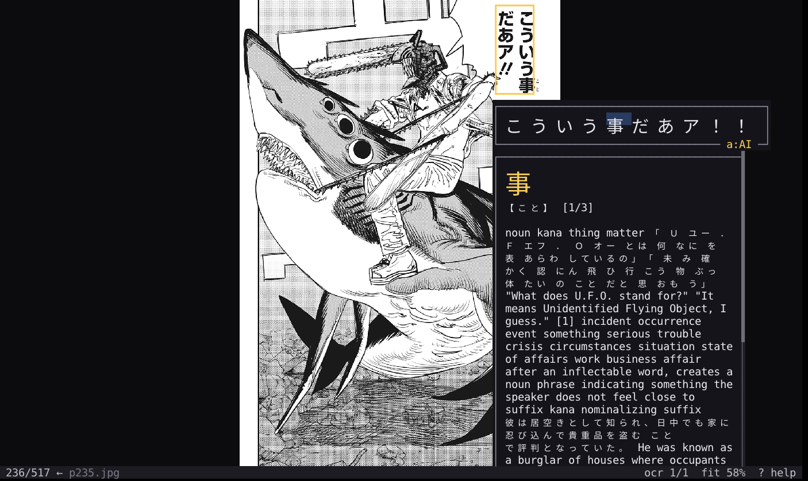

<!-- SPDX-License-Identifier: CC-BY-4.0 -->
# gw-read

A comic and manga reader. Pages are real bitmaps in the window, sized to
fit, zoomed and panned with the keyboard. For Japanese study it goes
further: with OCR text from [mokuro](https://github.com/kha-white/mokuro)
it shows a speech bubble's text you can click word by word for a
dictionary entry, asks an AI to translate a bubble, and makes Anki cards
from what you look up.

This page covers `gw-read` 0.9.2.



## Starting it

| Command | What it does |
|---|---|
| `gw-read book.cbz` | Open a `.cbz`, `.cbr` or `.cb7`, or a directory of images |
| `gw-read -p 40 book.cbz` | Open at page 40 instead of where you left off |
| `gw-read -m fit-width book.cbz` | Start in another sizing mode |
| `gw-read -d ltr book.cbz` | Western page order (the default is manga order, right to left) |
| `gw-read --list book.cbz` | Print the pages found and exit |

gw-read remembers each book's page, sizing mode and direction in
`read.state.json` in the config directory. salacommander opens comic
archives in it by default.

## Finding every command

Press **`?`** for the help overlay, which lists every key. The main ones:

| Key | Action |
|---|---|
| Space / Backspace | Next / previous page |
| Left / Right | Pan if the page overflows that way, else turn the page (following the reading direction) |
| Up / Down | Pan, else page |
| `h` `j` `k` `l` | Pan |
| `]` / `[` | Jump five pages |
| `gg` / `G`, Home / End | First / last page |
| `:` | Go to a page number |
| `f`, `w`, `t`, `1` | Fit the page, fit width, fit height, natural size |
| `+` / `-` | Zoom |
| `d` | Flip the reading direction |
| `q` | Quit |

## Reading with OCR text

When a book has a mokuro sidecar (`book.mokuro` beside it, or a
`*.mokuro` inside the archive or directory), gw-read knows where every
text bubble is and what it says.

- **Click a bubble**, or Tab / Shift+Tab through them, to open its text in
  a dialog beside the page (in the margin when there is room, so it
  covers no artwork). The text is re-flowed, vertically or horizontally.
- **Click a word** in the dialog to look it up in the dictionary. The
  entry opens in a side panel.
- Hold **`z`** to fade the dialog and read the artwork through it
  (mokuro often drops furigana); **`\`** hides it outright.
- **`o`** outlines every bubble on the page; **`v`** cycles vertical,
  horizontal and automatic layout; **`s`** / **`S`** resize the dictionary
  title and the dialog text.
- **`a`** asks an AI to translate the open bubble (off until configured).
- **`c`** makes an Anki card from what is showing: pick a crop of the page
  for context (drag to move, drag an edge to resize, Enter to keep it,
  Escape for no image), check the preview, and Enter sends it.

## read.conf.lua

Template: [`read/read.conf.template.lua`](../../read/read.conf.template.lua).

**Reading**

```lua
config = {
    direction = "rtl",        -- "ltr" for western comics
    mode = "fit",             -- "fit-width", "fit-height", "natural"
    upscale = true,           -- may a fit mode enlarge a small scan?
    jump_pages = 5,           -- how far ] and [ go
    remember_position = true,
    cache_pages = 8,          -- decoded pages kept for instant paging back
    prefetch = 1,             -- pages loaded ahead
    max_zoom = 4.0,
}
```

**Dictionary.** Point `dictionary` at an *unzipped* Yomitan-format
dictionary (Jitendex, for example), and optionally
`frequency_dictionary` at a frequency list (JPDB is the usual choice for
manga), which ranks results commonest-first. The first open builds an
index inside the dictionary's directory, once.

```lua
config = {
    dictionary = "~/.config/glyphwire/dicts/jitendex",
    frequency_dictionary = "~/.config/glyphwire/dicts/jpdb",
    ocr_dialog_placement = "margin",   -- or "bubble"
}
```

**AI translation** sends only the bubble's text (never images or the
book's path), so it is off until you turn it on. Providers are
`"openai"` and `"anthropic"` (API keys, named by environment variable),
`"claude_code"` (runs the `claude` CLI on your existing login) and
`"ollama"` (local):

```lua
config = {
    ai_lookup = true,
    ai_provider = "ollama",
    ai_model = "qwen2.5",
    ai_prompt = "Translate this for an intermediate learner. Keep it brief.",
    ai_confirm_before_send = true,   -- ask once per session
}
```

Answers are cached in `read.ai-cache.sqlite3`, so reopening a bubble
costs nothing.

**Anki cards** need desktop Anki running with the AnkiConnect add-on.
`anki_deck`, `anki_model` and `anki_fields` choose where a card goes and
which note field gets the term, reading, sentence, meaning, AI answer,
cropped image or audio. The default fields match jidoujisho's note type.

**Keys** are rebindable by action name, per mode (`page` for reading,
`card` while making a card, `confirm` and `busy` for the AI panel):

```lua
config = {
    keys = {
        page = { ["n"] = "nextPage", ["p"] = "prevPage", ["space"] = false },
        card = { ["y"] = "accept" },
    },
}
```

The template lists every action and its default key. `theme` gives
gw-read a theme of its own.

## Not there yet

- No automatic two-page spreads.
- OCR, lookup and cards need a mokuro sidecar made beforehand; gw-read
  doesn't run OCR itself.
- Dictionaries must be unzipped by hand once; gw-read doesn't read the
  `.zip` directly.
