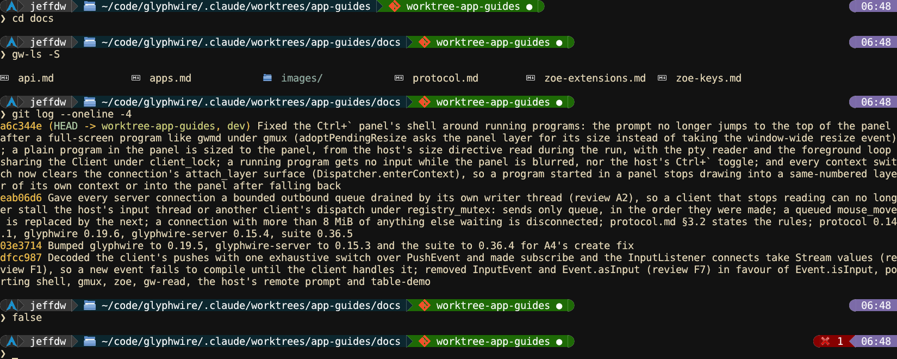

<!-- SPDX-License-Identifier: CC-BY-4.0 -->
# gw-shell

The shell every glyphwire window starts in. It runs ordinary commands
the way bash does, but it is also a glyphwire program itself: its prompt,
completion menus and history search are drawn as real UI, and programs
like `gw-ls` and `gw-grep` draw tables and outlines into its scrollback
that stay interactive after they exit. It is configured, and scripted, in
Lua.

This page covers `gw-shell` 0.13.1.



## The command line

Commands work the way they do in bash:

- Pipelines (`|`), `&&`, `||` and `;`.
- Redirections: `<`, `>`, `>>`, `2>`, `2>>`, `2>&1`, `1>&2`, `&>` and `&>>`.
- Quoting and expansion: `$NAME`, `${NAME}` and `$?` expand unquoted and
  in double quotes, never in single quotes. A leading `~` is `$HOME`.
  Unlike bash, an expanded value is never split into several arguments,
  so `ls $DIR` is one argument even if `$DIR` has a space in it.
- `export NAME=VALUE`, `unset NAME`, and `NAME=VALUE command` for one
  command's environment.
- A command can run over several lines: Enter on an open quote, a
  trailing `\`, or a dangling `|`, `&&` or `||` starts another line, and
  Alt+Enter forces one. A pasted multi-line `curl ... \` keeps its line
  breaks.

Builtins: `cd`, `exit`, `alias`, `unalias`, `export`, `unset`, `zj`,
`jobs`, `fg`, `reload` and `gwssh`, plus any you write in Lua (below).

## Keys at the prompt

| Key | What it does |
|---|---|
| Up / Down | Walk history |
| Ctrl+R | Fuzzy history search in [`gw-hist`](tools.md#gw-hist), seeded with what is typed |
| Alt+C | The same over frecent directories; Tab flips between the two |
| Alt+Up | Up one directory |
| Tab | Complete; see below |
| Right / End | Take the dim history suggestion whole |
| Ctrl+Right | Take its next word |
| Alt+Enter | Start another line of the same command |
| Ctrl+Up | Browse the scrollback with a cursor (below) |
| Super+Delete | Stop a foreground program that ignores Ctrl+C: SIGTERM, then SIGKILL after three seconds |

**Suggestions.** After a pause in typing, the newest history line that
continues what you typed shows as dim text after the cursor, fish style.
Entries naming paths that no longer exist are skipped.

**Completion.** Tab completes command names (builtins, aliases, scripts
and everything on `$PATH`), then arguments: from a Lua `defcomplete` for
that command if there is one, else from fish's completions when fish is
installed (subcommands, flags and branches, with descriptions), else file
names. On a path suggestion, Tab takes one segment at a time.

**Scrollback browsing.** Ctrl+Up leaves the prompt for a cursor in the
scrollback. Arrows move it, Ctrl+arrows jump, Enter acts on what is under
it (opens a `gw-ls` entry, say), and Escape or typing returns to the
prompt.

**Clicking output.** Clicking an entry in `gw-ls` output, or a hit in a
`gw-grep` outline, runs its *open action*: `cd` for a directory, zoe at
the right line for a text file, gw-view for an image. Ctrl+click marks
several first.

## Jobs

There is no `&`. Instead, a program that opens a screen of its own
(zoe, gwmd, salacommander) can be switched away from with the context
switcher (Super+F12) and keeps running. `jobs` lists those programs and
`fg [n]` brings one back. `exit` leaves them running.

## Jumping between directories: zj

Every `cd` is recorded, and `zj QUERY` jumps to the best match by
frequency and recency, like zoxide: `zj dow` goes to `~/Downloads` from
anywhere. The last word has to match the final path component. Bare `zj`
goes home.

## Remote shells

`gwssh host` opens a shell on another machine in a new pane. glyphwire
programs run there (zoe, gw-view, gw-ls) draw in your window exactly as
they do locally, images included, through
[gw-agent](tools.md#gw-agent).

## shell.conf.lua

Template: [`shell/shell.conf.template.lua`](../../shell/shell.conf.template.lua).
A working example with a two-line powerline prompt (the one in the
screenshot): [`assets/shell.conf.example.lua`](../../assets/shell.conf.example.lua).

Unlike the other programs' configs this one is a script that calls
functions, and it runs in the shell's own long-lived Lua state. The
`reload` builtin re-runs it in place, so an edit needs no restart.

**Aliases**

```lua
alias("ll", "gw-ls -lS")
alias("gs", "git status")
```

**The prompt.** A plain template, or powerline segments. Tokens include
`{cwd}`, `{user}`, `{host}`, `{time}`, `{env:NAME}`, `{icon:NAME}`,
`{exit}` (shown only after a failure) and `{dur}` (only after a slow
command), plus your own command variables:

```lua
prompt {
    commands = {
        is_repo = "git rev-parse --is-inside-work-tree 2>/dev/null",
        branch  = { "git branch --show-current", when = "{is_repo}" },
    },
    left_segments = {
        { " {user} ", fg = "#fff", bg = "#3a3a3a" },
        { " {cwd} ",  fg = "#fff", bg = "#3a6ea5" },
        { " {branch} ", fg = "#fff", bg = "green", when = "{is_repo}" },
    },
    right_segments = {
        { " {exit_code} ", fg = "#fff", bg = "#870000", when = "error" },
        { " {time} ",      fg = "#fff", bg = "#7c6ba8" },
    },
    lines = 2,
}
```

Colours can be `#rrggbb` or a theme name (`"green"`, `"accent"`), which
then follows the window's theme.

**Open actions.** What clicking a `gw-ls` or `gw-grep` entry runs, by
mimetype, mimetype group or kind:

```lua
open_actions{
    ["text/*"]          = "nvim +{line} {sel}",
    ["application/zip"] = "ark {selections}",
}
```

**Your own commands, in Lua.** `defcmd` registers a builtin, and a file
`scripts/<name>.lua` in the config directory is one too, re-read on every
call. The `sh` table reads and changes the shell's environment and
directory:

```lua
defcmd("mkcd", function(dir)
    os.execute("mkdir -p " .. dir)
    sh.chdir(dir)
end)

sh.setenv("PATH", "~/bin:$PATH")
```

`defcomplete(name, fn)` adds Tab completion for a command's arguments.
[`assets/scripts/`](../../assets/scripts/) has ready-made scripts
(`up`, `venv_activate`, `yoink`, ...) to copy.

Also in the template: the `zj` exclusions, the `kill_job` key, the
directory-change hook (by default a directory picked from a `gw-ls`
listing is listed again with the same flags), a theme of the shell's own,
and the suggestion, completion and scrollback-browsing switches.

## Not there yet

These are deliberate omissions, and each is a clear parse error rather
than a silent misreading:

- Background jobs with `&`, and bash-style job control (use the context
  switcher, `jobs` and `fg`).
- Heredocs (`<<`), here-strings (`<<<`), `|&` and process substitution
  (`<(...)`).
- Subshells `( ... )`, groups `{ ...; }`, and file descriptors above 2.
- `~user` paths.
- Builtins inside a pipeline.

There is no shell scripting language of its own (no `if` or `for` at the
prompt): write a Lua `defcmd`, or run a bash script.
