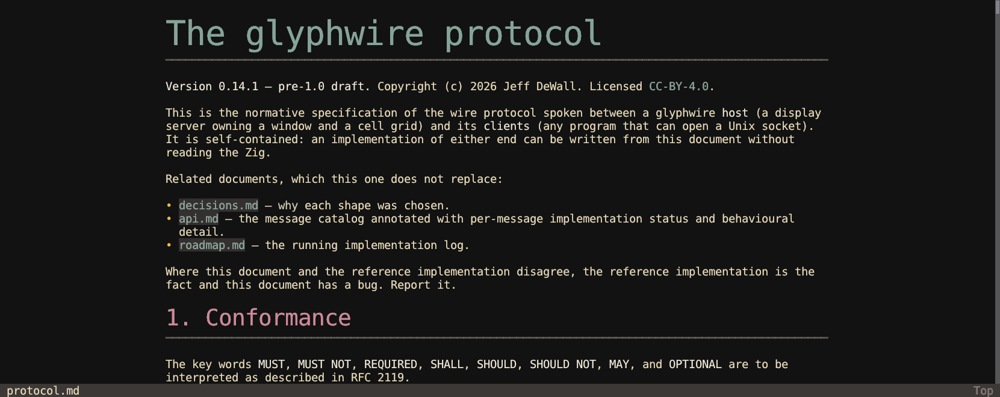

<!-- SPDX-License-Identifier: CC-BY-4.0 -->
# gwmd

A Markdown reader. Where a terminal pager shows Markdown as coloured
source, gwmd lays it out: headings at 1.5×, 2× and 3× the text size from
re-rasterized fonts, GFM tables as real tables, images inline, code
blocks on their own background, and links you can follow. It is meant
for reading READMEs and notes without leaving the window.

This page covers `gwmd` 0.11.1.

## Starting it

| Command | What it does |
|---|---|
| `gwmd README.md` | Open the file |
| `gwmd -m 80 README.md` | Cap the text column at 80 cells (default 100) however wide the window |
| `gwmd --dump README.md` | Print the laid-out text and exit, without a window (`-w` sets the width) |

salacommander opens `.md` files in gwmd by default, and gw-shell can do
the same from a `gw-ls` listing (an `open_actions` entry for
`text/markdown`).

## Reading

| Key | Action |
|---|---|
| Up / Down, `k` / `j` | Scroll a line |
| PageUp / PageDown, `b` / Space | Scroll a page |
| Home / End, `g` / `G` | Top / bottom |
| Tab / Shift+Tab | Highlight the next / previous link |
| Enter | Follow the highlighted link |
| Alt+Left, Backspace / Alt+Right | Back / forward through followed links |
| `r` | Reload the file |
| Escape | Drop the link highlight, else quit |
| `q` | Quit |

Where a link goes depends on what it points at:

- `#section` scrolls to that heading.
- Another Markdown file (or a directory, meaning its README) opens in
  gwmd, at its `#section` if it has one; Back returns.
- A web or mail link, an image or a PDF goes to the desktop's opener.

The file is watched: saving it in an editor re-reads it in place,
keeping the scroll position.

The document is one tall layer the host scrolls, so the wheel and the
scrollbar move it smoothly with nothing redrawn.

## Selecting and copying

Drag, double-click (a word) or triple-click (a line) to select, then
Ctrl+Shift+C. A wrapped paragraph copies as one line, without the margin,
rules or quote bars, so it pastes as the Markdown author wrote it.
Double-clicking the file name in the status line copies the file's
absolute path.

## Configuration

gwmd has no config file of its own. It draws in the window's theme
(Super+F10 switches it live; the screenshot below is Catppuccin Latte),
and its fonts and sizes come from `host.conf.lua`.

## Not there yet

- Its keys are not rebindable, and it has no config file for a theme or
  text width of its own (use `--max-width`).
- No search within the document.
