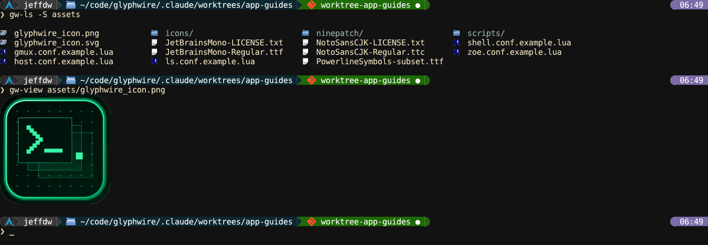

<!-- SPDX-License-Identifier: CC-BY-4.0 -->
# Small tools

Five smaller programs that mostly work from the shell: two that draw
interactive output into the scrollback, the history picker behind
Ctrl+R, an image viewer, and the remote end of an ssh session.

This page covers `gw-ls` 0.9.1, `gw-grep` 0.8.1, `gw-hist` 0.8.2,
`gw-view` 0.8.2 and `gw-agent` 0.9.0.

## gw-ls

`ls` with file-type icons, or with `-l` a long listing drawn as a real
table. The table is kept by the window, not the program, so long after
`gw-ls` has exited you can click a column header to re-sort it.


| Option | Effect |
|---|---|
| `-l`, `--long` | Long listing: permissions, size, owner, group, modified time |
| `-a`, `--hidden` | Include dotfiles |
| `-L`, `--large` / `-S`, `--small` | Large icons (the default) or small, compact rows |
| `--bytes` | Sizes as a byte count instead of KB / MB / GB |

Clicking an entry in the output runs its open action: a directory `cd`s
there and lists it again with the same flags (`gw-ls -aS` stays `-aS`),
and files open by type (text in zoe, images in gw-view). Ctrl+click marks
several, and Alt+drag carries an entry into another Wayland program,
even from far back in the scrollback. What each type opens with is
gw-shell's `open_actions` (see [gw-shell](gw-shell.md#shellconflua)).

`gw-ls` is not `ls`: alias it if you want it to be
(`alias("ls", "gw-ls -S")` in `shell.conf.lua`).

**ls.conf.lua** ([template](../../ls/ls.conf.template.lua)) sets the
icon sizes:

```lua
config = { small_icon_px = 16, large_icon_px = 32 }
```

Which icon set is drawn (Oxygen, Material, Papirus) is `icon_theme` in
`host.conf.lua`.

## gw-grep

ripgrep, with the hits drawn as a collapsible outline in the scrollback:
one branch per file, one per hit, with syntax-highlighted context lines.
The outline is kept by the window, so ▸ still expands a hit after
`gw-grep` has exited, and clicking a line opens the file at that line.


```
gw-grep [options] <pattern> [path...]
```

| Option | Effect |
|---|---|
| `-i`, `-w`, `-F` | Ignore case, whole words, literal pattern |
| `--hidden` | Search hidden files too |
| `-A n`, `-B n`, `-C n` | Context lines after, before, or both (default 10 after, 3 before) |
| `--expand` / `--collapse` | Start with every hit expanded / every file collapsed |
| `--no-syntax` | Skip highlighting |
| `-m n` | Stop after `n` hits (default 1000, `0` for all) |

Needs `rg` on `$PATH`. Highlighting uses zoe's grammars. No config file.

## gw-hist

The fuzzy picker gw-shell opens on **Ctrl+R** (history) and **Alt+C**
(frecent directories). Type to filter; the list re-ranks as you type.

| Key | Action |
|---|---|
| Up / Down, PageUp / PageDown | Move |
| Ctrl+R | Next match down, wrapping, like a shell's reverse search |
| Tab | Switch between history and directories |
| Enter | Put the history line at the prompt, or `cd` to the directory |
| Ctrl+U | Clear the query |
| Escape, Ctrl+C | Close |

It has no config file and its keys aren't rebindable yet.

## gw-view

An image viewer for PNG, JPEG, BMP and GIF.



| Command | What it does |
|---|---|
| `gw-view photo.png` | Draw it into the scrollback at the cursor and exit, shrunk to the window's width if wider |
| `gw-view -s full photo.png` | Draw it at its natural size |
| `gw-view -i photo.png` | Open it on a screen of its own with zoom and pan |

In the interactive view: `hjkl` or arrows pan, Space / PageUp / PageDown
move a screenful, Home / End go to the top and bottom, `f` / `w` / `t` /
`1` fit the image, its width, its height, or show it at natural size,
`+` / `-` zoom, and `q` or Escape quit. No config file.

## gw-agent

The far end of a remote session. `glyphwire --ssh host` (or `gwssh host`
from the shell) runs `gw-agent` on `host` over ssh. It opens a normal
glyphwire socket there and carries every program that connects to it
back over the one ssh connection, so a remote zoe, gw-ls or gw-view
draws in your window exactly like a local one, images included. It
never reads the protocol, only forwards bytes.

You don't run it yourself. It does need to be installed on the remote
machine: the release packages install it, and
`glyphwire --ssh host --remote-command /path/to/gw-agent` points at a
copy elsewhere.
