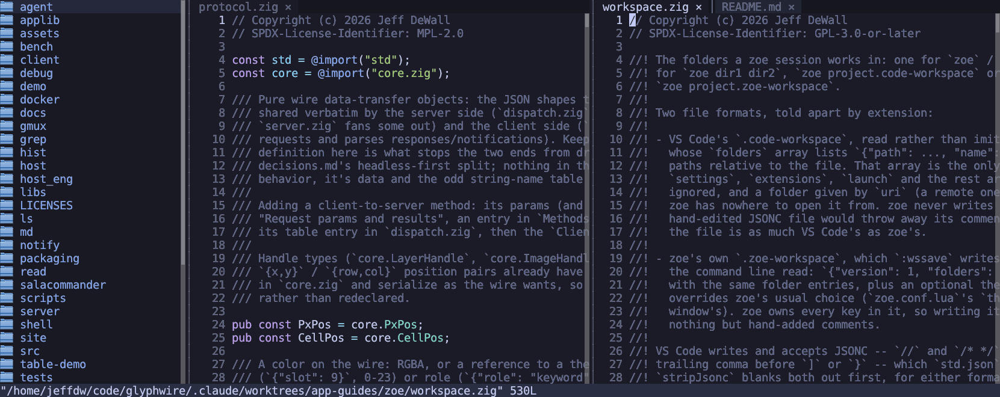

<!-- SPDX-License-Identifier: CC-BY-4.0 -->
# zoe

zoe is a text editor with vim's modal grammar and VS Code's keys side by
side: counts, operators like `dd` and `yy`, and `:s` for people with vim
in their fingers, and Ctrl+S, Ctrl+P, Ctrl+Shift+P and Shift+arrow selection for
everyone else. Around the text it has what a project needs: a file tree,
tabs, split editor groups, multi-folder workspaces, tree-sitter
highlighting, language servers, a drop-down shell, and unsaved changes
that survive quitting.

This page covers `zoe` 0.26.1. Every key is in the
[zoe key reference](../zoe-keys.md).



## Starting it

| Command | What it opens |
|---|---|
| `zoe file.zig` | That file |
| `zoe --line 120 file.zig` | That file at line 120 |
| `zoe src/` | The tree on `src/`, with an empty buffer |
| `zoe api/ web/` | A workspace: both folders, each its own section of the tree |
| `zoe project.zoe-workspace` | A saved workspace: folders, splits, tabs and theme. A VS Code `.code-workspace` opens too (its folder list) |

Typed in zoe's own shell panel (Ctrl+\`), `zoe file` opens the file in
*that* zoe, like `code` from VS Code's terminal, and `zoe dir` adds the
folder to its tree. `--wait` returns once the tab is closed, so
`EDITOR='zoe --wait'` works for git; `--new` forces a separate zoe.

## The screen

- **The file tree** on the left. Ctrl+B (or Ctrl+N, which also works
  under gmux) shows, hides and focuses it.
- **Editor groups**, each a tab strip over a buffer. `:vsplit` / `:split`
  (or Ctrl+W v / s) split the focused group; drag the divider to resize.
  A split starts as a second view of the same file, with its own cursor
  and scroll over the one text.
- **The status line** at the bottom: mode, file, position, diagnostics
  and messages. The `:` command line opens there.
- **The shell panel**, Ctrl+\`: a `gw-shell` docked over the bottom (or
  any edge, or floating; `:shell float`). Drag its edge to resize it.
  Clicking the tree or a buffer takes the keyboard back with the panel
  still up.

Click a tab to show it, middle-click or its × to close it, drag it to
reorder or onto another group to move it (Ctrl+drag copies it there).
Resting the pointer on a tab shows the file's full path.

## Modes

zoe starts in **normal** mode, as vim does.

| Mode | Enter it with | What keys do |
|---|---|---|
| Normal | Escape | Motions, operators and commands: `hjkl`, `w`, `dd`, `yy`, `p`, `u`, `gg`, `G` |
| Insert | `i`, `a`, `o`, `O`, `A`, `I` | Type text. Arrows, Ctrl+arrows and Shift+arrows move and select as in VS Code |
| Visual | `v` (characters), `V` (lines) | Select, then `d`, `y`, `c`, `>` / `<` |
| Command | `:` | An ex command line with history and Tab path completion |

If you never want modes: Ctrl+S saves, Ctrl+Z / Ctrl+Shift+Z undo and
redo, Ctrl+/ comments, Ctrl+F finds and Shift+arrows select, in any mode.
Insert mode is then an ordinary editor and Escape is only needed for
vim's keys.

## Finding every command: the palette

**Ctrl+Shift+P** opens the command palette. It lists every action that
isn't a plain motion or typing key, every `:` command, and every
`:set` option, each with its `:` form and the key that runs it in the
current mode:

```
Close Tab                 :bd          Ctrl+F4
Split Group Right         :vsplit
Toggle Word Wrap                       Alt+Z
```

Type to filter: by name, or by the `:` form (`bd` finds Close Tab).
Enter runs it; a command that needs an argument (`:theme`, `:addfolder`)
puts the `:` line up for you to finish. Recently used commands list
first, and commands added by extensions show here too.

That makes the palette the way to discover zoe: open it, type a word,
and read the key off the right-hand column.

## Everyday keys

| Key | Action |
|---|---|
| Ctrl+P | Fuzzy-find a file in the workspace |
| Ctrl+Shift+P | Command palette |
| Ctrl+S | Save |
| Ctrl+Tab / Ctrl+Shift+Tab | Next / previous tab |
| Ctrl+F4 or Ctrl+W x | Close the tab |
| Ctrl+Shift+N | New scratch buffer |
| Ctrl+F / Ctrl+H | Find / find and replace widget |
| `/` and `?`, then `n` / `N` | Search forward / back in normal mode |
| Shift+Enter | Jump: label every visible word with two letters, type one to go there |
| Ctrl+arrows | Move by word part (camelCase, snake_case); also between groups in normal mode |
| Alt+Up / Alt+Down | Move the line (Shift+Alt copies it) |
| `za`, `zM`, `zR` | Toggle a fold, close all, open all |
| `gd`, `K` | Go to definition, hover documentation (with a language server) |
| Ctrl+O / Ctrl+I | Back / forward through jumps |
| Ctrl+W | Window prefix: `v` / `s` split, `w` next group, `z` zoom, `q` close the group |
| Alt+H | Show dotfiles and `.gitignore`d files in the tree |
| Ctrl+Shift+E | Find the current file in the tree |

### In the file tree

| Key | Action |
|---|---|
| `j` / `k`, arrows, `g` / `G` | Move |
| Enter, Space, `l` | Open the file or folder |
| `a` (or Shift+F4) | New file; a name ending in `/` makes a folder, and `sub/new.zig` makes `sub` too |
| F7 | New folder |
| `r` (or F2) | Rename in place |
| `d` / `D` | To the trash / delete for good, after a `y` |
| `c`, `x`, `p` | Copy, cut, paste; a paste never overwrites, it offers a free name |
| `f` | Jump by name prefix |
| `/` | Search the whole tree, opening folders as needed |
| Ctrl+Shift+C | Copy the entry's absolute path |
| `q`, Escape | Back to the buffer |

## Workspaces

A workspace is several folders open as one session, each a section of
the tree, with Ctrl+P and the tree's search covering all of them.
`:addfolder dir` and `:rmfolder` change the folders, `:wssave file`
writes everything (folders, the split layout, every group's tabs, the
focus and the theme) to a `.zoe-workspace`, and `:wsopen file` switches
to one. A workspace you opened is saved again when you quit.

## Unsaved changes and hot exit

Every modified buffer is copied to `$XDG_STATE_HOME/glyphwire/zoe/backups`
about a second behind your typing, never next to the file. So `:q` quits
even with unsaved changes, and reopening the file brings them back as
one undoable step, as VS Code's hot exit does. `:q!` throws them away and
`:recover` opens every backup no tab has.

## Language servers

zoe starts a language server for a file when one is configured and its
binary is on `$PATH`. `zls` (Zig), `basedpyright` and `ruff` (Python) are
set up already. You get diagnostics (underlined, with a gutter sign and
the message in the status line; `]d` / `[d` step through them), `K`
hover, `gd` goto-definition and completion as you type (Ctrl+Space asks).
`:lsp` lists what is attached and what was looked for and not found.

Highlighting is tree-sitter: Zig, C, Python, Lua, Bash, JSON, TOML and
Markdown are bundled, with embedded languages (code blocks in Markdown)
highlighted too.

## zoe.conf.lua

Template: [`zoe/zoe.conf.template.lua`](../../zoe/zoe.conf.template.lua).
A working example: [`assets/zoe.conf.example.lua`](../../assets/zoe.conf.example.lua).

### Editor settings

```lua
config = {
    line_numbers = "relative",   -- false, "absolute", "relative"
    tab_width = 4,
    expand_tab = true,
    wrap = false,
    show_whitespace = false,
    auto_indent = true,
    auto_close = true,
    page_lines = 10,
    shell_position = "bottom",   -- "top", "left", "right", "float"
    backups = true,
    file_watch = "poll",         -- "inotify", "off"
    theme = "tokyo-night",       -- zoe's own theme; absent follows the window
}
```

Most of these can also be changed for the session with `:set`
(`:set wrap`, `:set lineno=relative`, `:set tabwidth=2`), which the
palette lists one by one.

### Key bindings

Every chord and named key (arrows, Home, Tab, F-keys) runs a *named
action*, and `keys` rebinds them by name. There are four tables: a key is
looked up first in the current mode's (`normal`, `visual`, `insert`) and
then in `global`. List only what you change; `false` takes a key away.

```lua
config = {
    keys = {
        global = {
            ["ctrl+h"] = "toggleHidden",   -- hidden files back on Ctrl+H
            ["alt+h"]  = "replace",
            ["ctrl+g"] = false,
        },
        insert = {
            -- Ctrl+arrows by whole word instead of word part.
            ["ctrl+left"]  = "wordLeft",
            ["ctrl+right"] = "wordRight",
            ["ctrl+d"]     = "deleteWordForward",
        },
        normal = {
            ["ctrl+t"] = "taskToggle",     -- an extension's command
        },
    },
}
```

To find an action's name, look it up in the palette (the names are in
[zoe-keys.md](../zoe-keys.md), which lists every action with its default
keys). Unmodified letters in normal and visual mode (`dd`, `gg`) are vim's
grammar and are not rebindable, nor are Escape, the `:` line's editing
keys, the tree's keys and the key after Ctrl+W.

### Languages and language servers

```lua
config = {
    -- More extensions for a bundled grammar, or a new grammar from
    -- grammar_dirs (a directory holding parser.so and highlights.scm).
    languages = {
        { name = "c", extensions = { ".c", ".h", ".ino" } },
        { name = "bash", extensions = { ".envrc" }, comment = "#" },
    },
    grammar_dirs = { "~/src/tree-sitter-grammars" },

    lsp = {
        servers = {
            { name = "zls", cmd = { "/opt/zls/zls" } },     -- a different binary
            { name = "ruff", enabled = false },             -- turn one off
            { name = "ty", languages = { "python" }, cmd = { "ty", "server" } },
        },
    },
}
```

### Extensions

Extensions are Lua scripts that add commands to the palette and the key
tables. zoe ships one, `task_journal`, a Markdown todo list and dated
journal compatible with VS Code's Task Journal extension. Turn it on by
name:

```lua
config = { extensions = { task_journal = { tags = { "MGMT", "BUG" } } } }
```

Your own go in `~/.config/glyphwire/zoe/extensions/<name>.lua`.
`:extensions` lists what zoe found and whether each loaded, and
[zoe-extensions.md](../zoe-extensions.md) covers writing one.

## Not there yet

For a vim user:

- Text objects (`iw`, `i(`, `ap`), so no `ciw` or `di(`; and `c` as an
  operator (`cw`, `cc`), though `C`, `s` and visual `c` exist.
- `.` repeat, `f` / `t` / `;` in-line find, `%`, `{` / `}`, `H` / `M` / `L`,
  `zz` / `zt` / `zb`.
- Marks, macros and named registers.
- Regular expressions: `/` and `:s` match literal text. No `:g`.
- `gu` / `gU`, and manual folds (`zf`).

For a VS Code user:

- Ctrl+A select all, and unshifted Ctrl+C / Ctrl+V (the window keeps
  Ctrl+Shift+C / V for terminal-style copy and paste).
- Find and replace across files (Ctrl+Shift+F / Ctrl+Shift+H).
- Ctrl+G go to line, F12 for definition, Ctrl+Shift+K delete line.
- Multiple cursors.

The pane layout itself is not configurable from `zoe.conf.lua` yet,
beyond what a saved workspace restores.
